# File Upload Recommended Architecture

The following describes the recommended architecture for handling file uploads

## Basic Upload

```mermaid
architecture-beta
    group aws(logos:aws)[API]

    service cdn(logos:aws-cloudfront)[CloudFront]
    service gw(logos:aws-api-gateway)[API Gateway] in aws
    service bucket(logos:aws-s3)[Destination] in aws
    service backend(logos:aws-ecs)[Backend] in aws
    service user(server)[User]

    cdn:R -- L:bucket
    gw:R -- L:backend
    backend:R -- T:bucket
    user:R -- L:gw
    user:T -- L:bucket
    bucket:R -- T:backend
```

## Image Processing

The following is an example of an image processing architecture

```mermaid
architecture-beta
    group aws(logos:aws)[API]

    service cdn(logos:aws-cloudfront)[CloudFront]

    service gw(logos:aws-api-gateway)[API Gateway] in aws
    service stagingBucket(logos:aws-s3)[Destination] in aws
    service cdnBucket(logos:aws-s3)[Assets] in aws
    service backend(logos:aws-ecs)[Backend] in aws
    service eda(logos:aws-eventbridge)[EventBridge] in aws
    service lambda(logos:aws-lambda)[ProcessImage] in aws


    cdn:R -- L:cdnBucket
    gw:R -- L:backend
    stagingBucket:R -- L:eda
    backend:R -- L:stagingBucket
    eda:T -- B:lambda
    lambda:L -- R:cdnBucket
```

